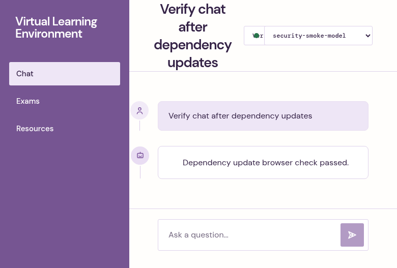

# Dependency security review — October 22, 2026

Baseline: `34ec5d3` (current origin/main at review time). This is an assessment
of repository dependencies, not a forensic assessment of past installs or running
deployments. No secret files were inspected.

## Incidents checked

| Incident | Before | After / assessment |
| --- | --- | --- |
| [Node October 21 security release](https://nodejs.org/en/blog/vulnerability/october-2026-security-releases) | Docker used floating `node:22-alpine`; CI requested Node 22. Local shell used 26.7.0. | Docker and CI select patched 22.23.4. Local 26.7.0 is affected; separately update it to 26.12.1 or another patched supported line. Running container versions were not inspected. |
| [Next image optimization RCE](https://github.com/vercel/next.js/security/advisories/GHSA-2464-fhr4-w9xw) and npm audit findings | Next 15.5.25, sharp 0.35.4. | Next 15.5.28 and sharp 0.35.5. The reported RCE requires glibc Linux and SVG image optimization; the supplied Docker image uses Alpine/musl, and no `next/image` use was found. The affected versions still warranted updating, including other Next advisories. |
| [Vitest mock code injection](https://github.com/vitest-dev/vitest/security/advisories/GHSA-qxg6-89mg-rqv8) and npm audit findings | Vitest 3.2.7 and vulnerable mocker/tinypool. | Vitest 4.1.12 replaces these dependencies; tests pass. These were development-tool findings, not proof of production exploitation. |
| [August Keyv/CHAINDROP compromise](https://www.wiz.io/blog/keyv-and-cacheable-npm-supply-chain-attack) | keyv 4.5.4, flat-cache 3.2.0, file-entry-cache 6.0.1. | Same versions remain. Neither lockfile has a malicious name/version match against the 446-package Wiz IOC list. |
| [October Tensorlake compromise](https://www.endorlabs.com/learn/tensorlake-npm-package-compromised-by-shai-hulud-in-latest-software-supply-chain-attack) | No tensorlake or tensorlake-native packages. | Still absent; compromised tensorlake 0.5.144 is not in either lockfile. |

The Keyv check compared every nested `node_modules` lock entry against every
comma-separated malicious version in the [researchers' CSV](https://github.com/wiz-sec-public/wiz-research-iocs/blob/main/reports/keyv-packages.csv).
CSV SHA-256 at review time:
`138c7a54f25d90ae339f4de652c49bd663c0a8a4accbf921707178b0e90330a0`.
Zero matches establishes only that those listed malicious versions are absent
from these lockfiles. It cannot rule out an earlier install, a different campaign,
or malware already on a machine. npm audit alone does not establish malware safety.

## Updates and pins

- Pin all 12 direct npm runtime/development dependencies to exact versions.
  Preserve existing versions except Next/eslint-config-next 15.5.28 and Vitest 4.1.12.
- Refresh vulnerable compatible transitive dependencies, including sharp 0.35.5,
  source-map-js 1.2.2, brace-expansion 1.1.21/5.0.12, and Vite 8.3.5
  (supported by Vitest 4.1.12).
- Override Next's exact PostCSS 8.4.31 dependency with 8.5.31 to address
  its source-map disclosure advisories; the production build verifies compatibility.
  Reevaluate this override when Next updates its own PostCSS pin.
- Pin all six Python runtime/dev dependencies and setuptools 84.2.1.
  Upgrade pypdf 6.19.0 to 6.21.1 for eight reported advisories involving
  malicious PDFs ([upstream security advisories](https://github.com/py-pdf/pypdf/security/advisories)).
- Pin Docker runtime versions and multi-platform image digests, uv 0.12.10,
  and GitHub Actions commit SHAs. CI reads Node's version from `frontend/.nvmrc`.
  `engines.node` declares patched minimums on the 22/24/26 lines.
- Python compatibility constraints, package-internal version ranges, and the
  GitHub-hosted `ubuntu-latest` runner selector remain compatibility/platform
  declarations; repository lockfiles and image digests pin the resolved packages.

## Audit results and remaining issue

| Check | Before | After |
| --- | --- | --- |
| Full npm audit | 14 affected packages: 3 critical, 10 high, 1 moderate | 5 high, 0 critical |
| Production-only npm audit | Not separately measured | 0 |
| Python locked-package audit | 8 advisories in pypdf 6.19.0 | 0 |

The five remaining npm findings are one dependency chain:
`eslint-config-next → @next/eslint-plugin-next → fast-glob → micromatch → braces`.
[GHSA-vfj7-8cjw-p6xm](https://github.com/advisories/GHSA-vfj7-8cjw-p6xm)
reports stack exhaustion on deeply nested patterns; the latest braces 3.0.3
remains affected, with no published patched release at review time. These are
dev-only dependencies. npm proposes downgrading eslint-config-next to 14.2.35;
that would mismatch Next 15 and is not applied. Do not run `npm audit fix --force`
to suppress this finding. Recheck when upstream publishes a compatible fix.

## Verification

- Backend: `uv run pytest -q` — 182 passed.
- Both production Docker images built successfully (frontend from a clean source
  context); smoke tests verified Node 22.23.4, native sharp loading, Python 3.13.17,
  and pypdf 6.21.1.
- Frontend under checksum-verified official Node 22.23.4: clean
  `npm ci --ignore-scripts`, `npm run lint`, `npm test` (6 passed),
  and `npm run build` passed, including TypeScript checks.
- `npm audit --omit=dev --package-lock-only --ignore-scripts`: zero findings.
- `uv export --locked --no-emit-project --no-hashes` followed by
  `uvx pip-audit --disable-pip --no-deps`: zero findings.
- Playwright MCP: production build navigation; real API library empty state
  and feature-disabled exam state; chat submission/answer rendering with mocked
  model/chat endpoints. No live LLM generation was tested.

Browser smoke-test evidence (mocked model response):

